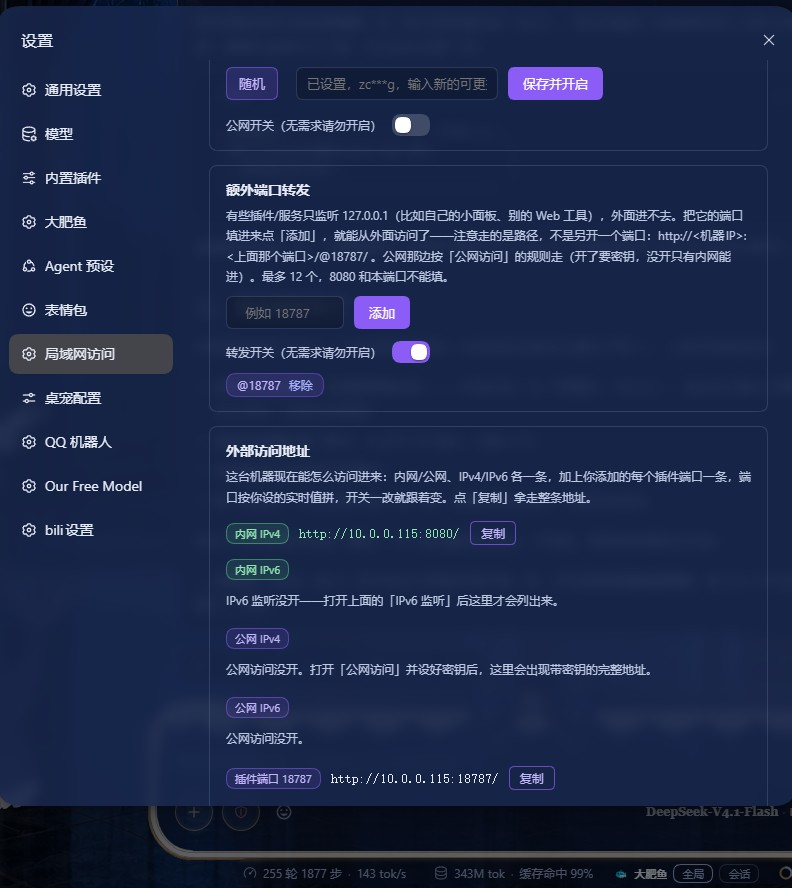
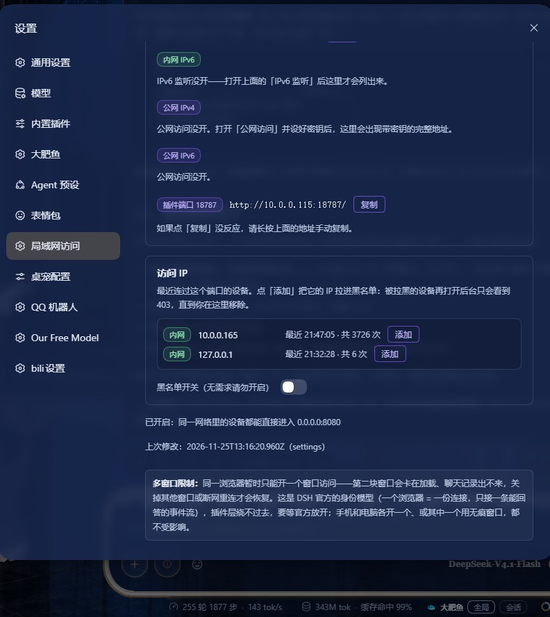

<p align="center">
  
</p>

<h1 align="center">dsh-plugin-reverse-proxy</h1>

<p align="center"><a href="README.md">简体中文</a> ｜ English</p>

<p align="center">
  <a href="LICENSE"></a>
  <a href="https://www.npmjs.com/package/dsh-plugin-reverse-proxy"></a>
  <a href="https://www.npmjs.com/package/dsh-plugin-reverse-proxy"></a>
  <a href="https://github.com/llifco/dsh-plugin-reverse-proxy/releases/latest"></a>
  
  
  <a href="#scope"></a>
  <a href="https://github.com/llifco/dsh-plugin-reverse-proxy/actions"></a>
  <a href="https://github.com/llifco/dsh-plugin-reverse-proxy/stargazers"></a>
  <a href="#community"></a>
</p>

> One command and any device on your LAN — phone, tablet, another laptop — can open your DSH web UI,
> **without copying the random token out of the startup log**.
```bash
dsh plugin --profile web add dsh-plugin-reverse-proxy   # recommended: npm package, no build
```

Then open **Settings → LAN access**: it listens on loopback only by default, flip the switch,
confirm — your phone can connect.
(You can also install from source: `github:llifco/dsh-plugin-reverse-proxy`, see [Install](#install).)


---

## What it looks like

**Settings → LAN access** (0.9.0, one page; off by default, flipping it asks for confirmation first).
Master switch with a **Contact the author** button, IPv6 listener, port, public access + key (**Random** button), **extra port forwarding** (publish ports that only listen on 127.0.0.1), **external addresses** (one row each for LAN/WAN IPv4+IPv6, plus one row per forwarded port, live port, one-click copy) and the access-IP blacklist:

<p align="center">
  
</p>

<p align="center">
  
</p>

<p align="center">
  
</p>

No GUI around? The same switch works from a terminal (`yes` is required) — see [Usage](#usage).


**Access IPs and blacklist** (0.5.0+) — hit "Add" to blacklist a device; it then only sees a 403 page:

<p align="center">
  
</p>

<p align="center">
  
</p>
---

## Eight capabilities

> Since 0.3.5: the settings switch is purple, and the **listening port** is editable
> (default 8080, applied on save, kept across restarts).

### 1. Reverse proxy (on by default)

```
LAN browser ──▶ 0.0.0.0:8080 (this plugin)
                   │  rewrite headers:
                   │    Host             → 127.0.0.1:3080
                   │    Origin           → http://127.0.0.1:3080
                   │    Sec-Fetch-Site   → same-origin
                   │    Referer          → cleared
                   │  plus: X-Real-IP / X-Forwarded-For / X-Forwarded-Proto
                   ▼
            127.0.0.1:3080 (dsh web itself)
```

`dsh web` binds to loopback only and validates `Host` / `Origin`, so exposing it directly
returns 403. nginx used to rewrite those headers; now the plugin does.

- streaming, no buffering (SSE and large downloads stay smooth)
- WebSocket: hand-rolled 101 tunneling over `net.connect`
- 3600s long-connection timeout to match nginx; 200 MiB request body cap
- retries every 5s when the port is taken; never throws during load

### 2. LAN access switch and port (off by default / 8080)

The proxy only listens on `127.0.0.1:8080` — reachable from **this machine only**.
To share the UI with a phone, tablet or another computer on the same Wi-Fi / LAN you must
explicitly turn it on through one of three entries, all backed by the same state file:

```bash
# terminal
reproxy-lan status     # show state
reproxy-lan enable     # prints the warning, needs the word yes
reproxy-lan disable    # turn off immediately
reproxy-lan port 9000  # change the listening port (1024-65535; 3080 is DSH's own)
```

```
/lan status    /lan yes    /lan no      # or the slash command in the DSH input box
```

or **Settings → 局域网访问 (LAN access)** → flip the switch → confirm the warning dialog.

#### Command reference (slash commands and terminal line up one-to-one)

| What you want | In chat | Over SSH |
|---|---|---|
| Show status | `/lan status` | `reproxy-lan status` |
| Enable / disable LAN access | `/lan yes` / `/lan no` | `reproxy-lan enable` / `disable` |
| Change the port | `/lan port 9000` | `reproxy-lan port 9000` |
| Enable / disable the IPv6 listener | `/lan ipv6 on` / `off` | `reproxy-lan ipv6 on` / `off` |
| One-shot public access (random key) | `/lan public on` | `reproxy-lan public on` |
| Public access with your own key | `/lan public on <key>` | `reproxy-lan public on <key>` |
| Close public access only | `/lan public off` | `reproxy-lan public off` |
| Change the key | `/lan key <key>` | `reproxy-lan key <key>` |
| **List every reachable address** | — | `reproxy-lan addresses` (aliases `urls` / `addr` / `a`) |
| Extra port forwarding | `/lan forward add 18787` | `reproxy-lan forward add 18787` |
| Show / remove forwarded ports | `/lan forward` / `/lan forward del 18787` | `reproxy-lan forward` / `forward del 18787` |
| Enable / disable forwarding | `/lan forward on` / `off` | `reproxy-lan forward on` / `off` |
| Restore defaults | `/lan reset yes` | `reproxy-lan reset` |

Terminal example (`status` → `enable` → typing `yes` → listening on `0.0.0.0:8080`):


### Changing the port (default 8080)

The same settings page has a **port** field: type a number → **Save** → the listener is
rebuilt immediately (**no restart needed**) and the value survives restarts.
Rules: 1024–65535, never 3080 (that is DSH itself); an unavailable port returns 409 and
nothing changes.

```
/lan port           show the current port
/lan port 9000      change it (or `reproxy-lan port 9000` over SSH)
```

State lives in `<DSH_HOME>/plugin-reverse-proxy/lan-access.json`
(`{"lanAccess": true, "port": 8080, ...}`), so it survives `systemctl restart dsh`;
edits to that file are picked up within a second (`fs.watch`).

> ⚠️ Once enabled, any device on the same network can open `http://<machine-ip>:8080` and get
> the full back end (sessions, terminal, settings) with no token and no login.
> Only enable it on a network you trust.

---

### 3. Public access and access key (off by default)

The main switch only covers the LAN: requests arriving from a public IP get a **403 "LAN only"** page.
To open it to the internet, add a second gate — **public switch + access key**:

- Settings: **Settings → LAN access → Public access**, type an access key (5–64 characters, letters and digits only;
  pinyin is fine, symbols are not), then hit **Save and enable**. The switch will not turn on without a key.
- Slash command: `/lan public` (status), `/lan public on <key>`, `/lan public off`, `/lan key <key>`.
- Terminal: `reproxy-lan public on` (shows the warning, asks for `yes`, then **generates a random 12-character key**, opens the main + public switches and prints the reachable URLs), `reproxy-lan public on <key>`, `reproxy-lan public off` (closes the public switch only, key kept), `reproxy-lan key <key>`, `reproxy-lan addresses` (list every reachable URL at any time); `status` shows the masked key.

The URL becomes:

```
http://<public-ip>:<port>/<access-key>
```

Opening that URL once plants a **30-day cookie**; refreshes, assets and the WebSocket channel then work without the key
in the URL. A request with no key, or the wrong key, gets a **404** — it does not advertise that a backend lives there.

- The key is the only credential: change it and every old URL stops working immediately.
- Public mode only constrains **non-private** sources: LAN devices (192.168 / 10 / 172.16-31 …) still connect without a key, and loopback is always allowed (so a forgotten key can always be fixed locally).
- `reset` turns public access off and clears the key.

> ⚠️ Two things to keep in mind: (1) this plugin only *allows* traffic — reaching it from the internet still depends on
> your router / firewall port forwarding; (2) treat the key like a key — don't paste it into group chats, screenshots or issues.

### 4. IPv6 listener (off by default)

Right below the main switch there is an **IPv6 listener** toggle. When enabled, the proxy binds an extra `[::]:<port>`:

- Devices on the same network that use **IPv6** (most phones and many ISP links prefer IPv6) can open `http://[ipv6-address]:<port>` directly.
- It follows the main switch: it is disabled while "LAN access" is off (the API answers 400), and turning the main switch off disables IPv6 too.
- It follows public access as well: when public access is on, IPv6 sources must present the access key, same as IPv4.
- A warning dialog appears first: **many ISP IPv6 links have no NAT**, so if your router lets traffic through and the address gets scanned, outside devices may reach you. Leave it off if unsure.

Terminal: `reproxy-lan ipv6 on` / `reproxy-lan ipv6 off`; slash command: `/lan ipv6 on|off`.

### 5. External addresses (one glance, ready to copy)

Below "Public access" there is an **External addresses** card that works out how this machine can be reached right now:

- One row each for **LAN IPv4 / LAN IPv6 / public IPv4 / public IPv6**, built with the port you actually configured (change the port and the rows follow immediately).
- When public access is on, the public rows include the access key, so they are complete URLs you can paste straight into a browser; when it is off you get a hint instead of a dead link.
- Missing public addresses are explained per row: IPv4 is usually carrier NAT / CGNAT ("forward the port on your router first"), IPv6 means "this machine only has a LAN IPv6".
- Only real interfaces are listed: `lo`, docker, veth, bridges, tun/tap, WireGuard, Tailscale and container subnets are skipped, and the IPv6 row picks the address with the **longest lifetime**.
- A **Copy** button sits on each row; if copying does nothing on a phone, long-press the address — the card says so too.

### 6. Extra port forwarding (off by default)

Plenty of add-ons only listen on `127.0.0.1` — their own little panel, a debug page, some
other web tool — so neither the LAN nor the internet can reach them. Drop the port into
this field, hit **Add**, and it is **published alongside LAN access**:

- LAN: `http://<machine-ip>:<that-port>/`, straight in, same as 8080
- Public: follows the public-access rule — with public access on you need the key first
  (log in once through 8080 with the key; the cookie then covers every forwarded port)
- Blacklist, the 403 page and address copying all apply

Limits: up to **12** ports; `8080` (the proxy itself) and `3080` (DSH itself) are refused;
ports must be 1024–65535. Turning the LAN switch off drops them all; turning it back on
restores them.

After adding, the **External addresses** card grows one row per port (up to 12; a single
hint line when none). Each row is health-checked — if nothing listens on that port it says
so instead of handing you a 502 later.

The master switch card also carries a **Contact the author** button (QQ group 1065464637).

```
/lan forward            show the switch and the ports
/lan forward add 18787  add one
/lan forward del 18787  remove one
/lan forward on         enable forwarding (LAN switch must be on)
```

### 7. Access IPs and blacklist (off by default)

- Lists every device that recently hit the port; each row is three lines:
  - tiny grey `MAC 00:0e:c6:8e:bd:84` (only for IPv4 devices on the same L2 segment; otherwise
    `MAC 未知`, and across a router or from the internet it is never visible);
  - **one** device line: `设备 PJZ110 · 浏览器 Chrome 131 · 系统 Android 14` (on a PC:
    `设备 电脑 · 浏览器 Edge 154 · 系统 Windows 10/11`; anything undetected says `未知`);
  - the `IP · last seen · request count` line in small red text.
- **Add** drops that IP into the blacklist; the device then gets a 403 page until you remove it.
- A **blacklist switch** sits right below the list ("no need, do not enable") — turning it off stops blocking but keeps the list.
- Adding the same IP twice is a no-op (`added:false`); loopback and the device you are currently using cannot be blocked (HTTP 400), so you cannot lock yourself out.
- The list is stored in the same state file (`blacklistEnabled`, `blockedIps`) and survives restarts.

**Reset (safety valve for misconfiguration):**

```bash
reproxy-lan reset      # shows what will be restored, then asks you to type yes
```

Or `/lan reset` in chat, confirmed with `/lan reset yes`. Reset turns LAN access off, port back to 8080,
blacklist off and clears the list — devices currently connected over 8080 drop immediately, by design.

### 8. Token-free login (version-gated)

Replaces the official `@deepseek-ai/dsh-client-connection` provider and skips BrowserAuth.

- **web-only**: desktop hosts go dormant (process-tree detection), official behavior untouched
- **strict allowlist**: the runtime and connection packages must both match a known version,
  otherwise it sleeps and the official connection row stays as-is
- **no patching of DSH itself**: only the official plugin patch mechanism is used; remove or
  disable the plugin and everything is back
- covered: `0.1.2-rc.1` `0.1.5-rc.1/rc.2` `0.1.7-rc.1/rc.2` `0.2.0-rc.1/rc.2` `0.2.1-rc.1~rc.5` `0.2.2-rc.1/rc.2/rc.3`

> Based on and partly inlined from [`@iasiv5/dsh-skip-browser-auth`](https://github.com/iasiv5/dsh-skip-browser-auth) (MIT),
> kept under `vendor/skip/` with its LICENSE and NOTICE.

---

## Notes (read before turning on public access)

- **Reaching you from the internet is not the plugin's job.** The plugin only decides "allowed here, key required" on this machine; the real door is your router / firewall port mapping (`8080` → this host). Without it, a public URL simply will not connect.
- **Traffic is plain HTTP.** The key guards *who can get in*, not *what travels*. For long-term public exposure, put it behind HTTPS (Cloudflare Tunnel, frp + TLS, Tailscale) or use it only temporarily.
- **Lost the key?** `127.0.0.1` is always allowed: open `http://127.0.0.1:8080`, change it in Settings, or run `reproxy-lan key <new-key>`; if things are messy, `reproxy-lan reset` restores defaults (LAN + public off, blacklist and key cleared).
- **The blacklist stops accidents, not attackers.** It refuses a specific IP; it does not stop port scans or traffic floods. On the public internet, restrict ports at the firewall too.
- **One tab per browser.** That is DSH's own identity model (one browser = one connection) and the plugin cannot bypass it; other devices or a private window are unaffected.
- **Pick a sane port.** `80`/`443` need root and are often taken; `3080` is dsh itself. The plugin accepts `1024–65535`.

---

## Why the marketplace marks "executes assembled code at runtime"

The marketplace detail page scans every package statically (the "What it does" block), and ours lights up `Execution → runs code assembled at runtime`. It is accurate, but the reason is mundane: the bundle contains four `eval` / `new Function` sites.

| Where | Code | Origin |
|---|---|---|
| `vendor/skip/gate.js:125` | `new Function('ctx', 'expr', 'with (ctx) { return eval(expr) }')(ctx, GATE_PROBE_EXPRESSION)` | This plugin's own compatibility probe: `disabled:` entries in `cordis.patch.yml` are expressions, and matching one at runtime requires evaluating it — same semantics as DSH's own loader |
| `vendor/skip/client.js:5654` | `new Function("return " + schema.callback)()` | DSH's official schemastery build, vendored as part of the official client bundle |
| `vendor/skip/client.js:12138` | same | same |
| `vendor/skip/client.js:13639` | same | same |

In other words: **the plugin never downloads or remote-loads code**. The flag is a pattern match on "string executed as function", which is why "Network access" and "Reads/writes local files" light up too (`net` / `fs` calls).

Removing the flag entirely would mean dropping the vendored official frontend — i.e. no settings panel — so we keep it and explain it here.

---

## Scope

| Where | Supported |
|---|---|
| **Web UI** (`http://<LAN-IP>:8080`, port configurable, LAN access switch must be on) | ✅ what it is for |
| **Desktop / client app** | ❌ pointless there |

The desktop app runs locally and can hit `127.0.0.1:3080` directly — no proxy, no auth skip needed.

---

## Install

**From npm (easiest; also listed in awesome-dsh-plugin)**

```bash
dsh plugin --profile web add dsh-plugin-reverse-proxy
```

or search `reverse-proxy` in the plugin marketplace and hit Install.

**From source**

```bash
git clone https://github.com/llifco/dsh-plugin-reverse-proxy.git
cd dsh-plugin-reverse-proxy
dsh plugin --profile web add .
```

or use the tarball from the releases page / npm (filename carries the current version):

```bash
dsh plugin --profile web add ./dsh-plugin-reverse-proxy-0.4.3.tgz
# or: https://registry.npmjs.org/dsh-plugin-reverse-proxy/-/dsh-plugin-reverse-proxy-0.4.3.tgz
```

Restart the host once:

```bash
systemctl restart dsh
```

By default it listens on `127.0.0.1:8080` only, so first check `http://127.0.0.1:8080` locally.
To let other devices in, enable the LAN access switch (`reproxy-lan enable`, `/lan yes`, or
Settings → LAN access) and then open `http://<LAN-IP>:8080` — no token.

---

## Configuration

Reverse proxy (the `dsh-plugin-reverse-proxy` row in `cordis.patch.yml`):

| Key | Default | Former nginx directive |
|---|---|---|
| `listenHost` | decided by the LAN switch (default `127.0.0.1`) | `listen 127.0.0.1:8080` |
| `listenPort` | `8080` | same |
| `listenIpv6` | `false` | `listen [::]:8080` |
| `upstreamHost` / `upstreamPort` | `127.0.0.1` / `3080` | `proxy_pass` |
| `upstreamHostHeader` | `127.0.0.1:3080` | `proxy_set_header Host` |
| `upstreamOrigin` | `http://127.0.0.1:3080` | `proxy_set_header Origin` |
| `maxBodyBytes` | `209715200` | `client_max_body_size 200m` |
| `retryMs` | `5000` | — (port-conflict retry) |

`trustedHosts` for the token-free rows is injected by DSH's web runtime; usually no manual edit.

---

## Layout

```
dsh-plugin-reverse-proxy/
├── index.js                  # entry: dispatch by cordis row id (proxy / skip-auth)
├── cordis.patch.yml          # official patch: version gate + the capability rows
├── assets/logo.jpg           # repo avatar
├── vendor/skip/              # token-free implementation (MIT, from dsh-skip-browser-auth)
│   ├── host.js  gate.js  compatibility.js
│   ├── trust-fence.js  trusted-auth.js  bridge.js
│   ├── connection-runtime.js
│   ├── adapters/             # carrier-neutral / -017 / -021
│   └── client.js             # prebuilt browser bundle
├── dist/*.tgz                # packaged builds (offline install)
├── CHANGELOG.md
├── README.md / README.en.md
└── LICENSE
```

---

## Uninstall / roll back to nginx

```bash
dsh plugin --profile web remove dsh-plugin-reverse-proxy
systemctl restart dsh
```

Back to nginx:

```bash
ln -sf /etc/nginx/sites-available/dsh /etc/nginx/sites-enabled/dsh
nginx -t && systemctl reload nginx
```

---

## FAQ

**Only this machine can open it; my phone cannot?**
That is the 0.3.2+ default (`127.0.0.1` only). Enable the switch — `reproxy-lan enable`,
`/lan yes`, or Settings → LAN access. `ss -ltnp | grep 8080` should then show `0.0.0.0:8080`.

**Port 8080 still dead after install?**
`ss -ltnp | grep 8080` — if nginx still owns it, the old `sites-enabled/dsh` symlink is still there.

**It asks for a token again?**
The skip-auth half went dormant, usually because DSH was upgraded past the allowlist.
Check the log for `BrowserAuth has been skipped`; absent means dormant (official behavior).

**Can it reach the internet?**
No, and it should not. It only makes LAN access work; add your own tunnel plus auth.

**Does the desktop app use it?**
No — connect to `127.0.0.1:3080` directly.

**Q: Opening a second window on the same device shows a blank page and no chat history?**

Fixed in 0.3.6. Without an identity layer every browser request shares one
`browserPeer`, and a Peer serves only the stream bound to it — the second
window's stream competed for the same endpoints and waited forever until every
window was closed. Each mux connection now mints its own Peer. Look for
`[reproxy-lan] per-socket peers enabled (multi-window)` in the log to confirm.

---

## Feedback

- Bugs / feature requests: **QQ 3538638569** (3538638569@qq.com)
- Include `dsh --version`, `dsh plugin --profile web list` and the relevant log lines.

## License

MIT (`vendor/skip/` code comes from @iasiv5/dsh-skip-browser-auth, also MIT).

**Q: A second tab on the same device stays on a spinner?**

**Known limitation: multiple tabs of the same browser are not supported yet.** The second tab
spins forever and shows an empty session list; closing the other tabs (or a network reconnect)
recovers it. One tab per device, or one of them in a private window, works fine.

Cause is upstream: one browser cookie = one Peer = one answering event stream, and the gateway
routes events to the single live client rather than per tab. 0.4.x already gives each tab its own
identity (`x-dsh-tab` header plus `?tab=` on the mux — visible as `http tab ...` / `mux admit ...`
in the log), but the gateway still accepts only one answering stream, so the plugin cannot work
around it.

---

## Community

Questions, ideas and war stories: **QQ group 1065464637**.

For bugs, please open an [Issue](https://github.com/llifco/dsh-plugin-reverse-proxy/issues/new/choose) — the template asks for your DSH version, switch state and logs, which is far faster than guessing.
