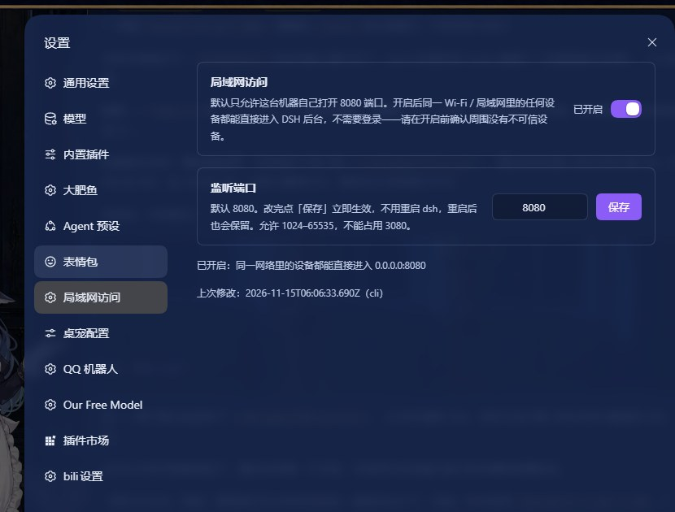
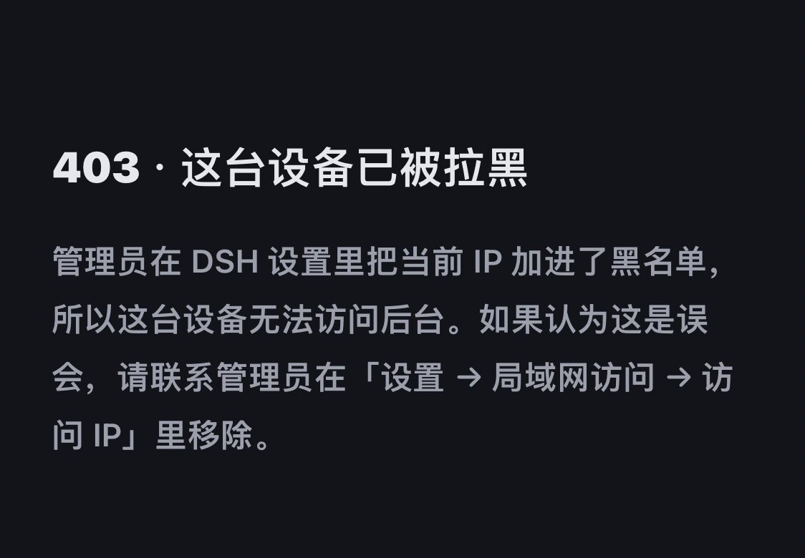
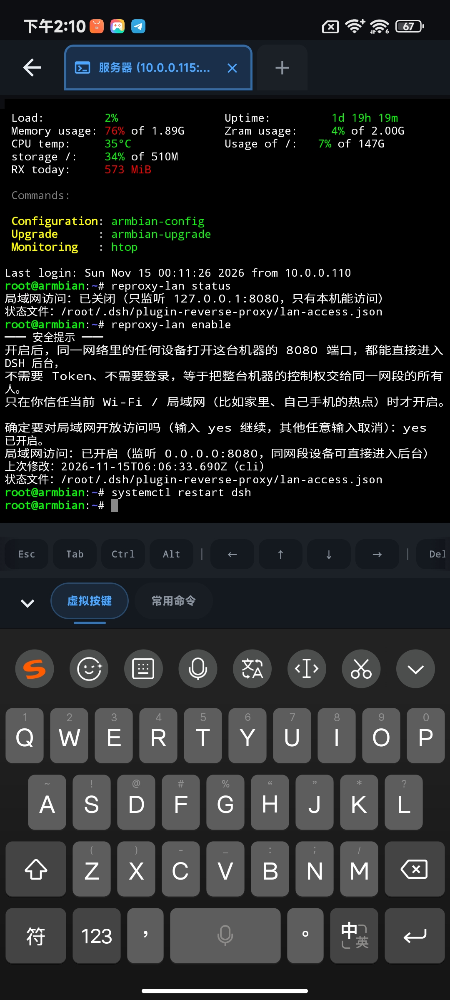

<p align="center">
  
</p>

<h1 align="center">dsh-plugin-reverse-proxy</h1>

<p align="center">简体中文 ｜ <a href="README.en.md">English</a></p>

<p align="center">
  <a href="LICENSE"></a>
  <a href="https://www.npmjs.com/package/dsh-plugin-reverse-proxy"></a>
  <a href="https://www.npmjs.com/package/dsh-plugin-reverse-proxy"></a>
  <a href="https://github.com/llifco/dsh-plugin-reverse-proxy/releases/latest"></a>
  
  
  <a href="#适用范围"></a>
  <a href="https://github.com/llifco/dsh-plugin-reverse-proxy/actions"></a>
  <a href="https://github.com/llifco/dsh-plugin-reverse-proxy/stargazers"></a>
  <a href="#%E4%BA%A4%E6%B5%81%E7%BE%A4"></a>
</p>

> 一条命令装上，局域网里的手机、平板、另一台电脑就能直接打开你的 DSH 网页界面，
> **而且不用再从启动日志里抄那串随机 token**。
> 出门在外想用？打开「公网访问」设个密钥，地址变成 `http://公网IP:8080/你的密钥`——不知道密钥的人只会看到 404。

```bash
dsh plugin --profile web add dsh-plugin-reverse-proxy   # 推荐：npm 包，免构建
```

装完打开 **设置 → 局域网访问**：默认只监听本机，点开关 → 确认 → 手机就能进。
（也可以 `github:llifco/dsh-plugin-reverse-proxy` 从源码装，见 [安装](#安装)。）

---

## 长什么样

**设置 → 局域网访问**（0.6.0 一页搞定）：总开关、监听端口、公网访问与密钥、访问 IP（每行带「公网 / 内网」标签，卡片内滚动）。点开关会先弹一次安全确认：

<p align="center">
  
</p>

点「添加」把设备拉黑，它再打开后台只会看到 403：

<p align="center">
  
</p>

没开图形界面时，终端里也能开关（`yes` 才真的开）——见下面 [怎么用](#怎么用)。

---

## 七个能力

> 0.3.5 起：设置页开关换成紫色，**监听端口**也能自己填了（默认 8080，保存即生效，重启保留）。

### 1. 反向代理（默认启用）

```
局域网浏览器 ──▶ 0.0.0.0:8080 (本插件，开关开启后才会监听；端口可改)
                    │  改写请求头：
                    │    Host             → 127.0.0.1:3080
                    │    Origin           → http://127.0.0.1:3080
                    │    Sec-Fetch-Site   → same-origin
                    │    Referer          → 清空
                    │  补充：X-Real-IP / X-Forwarded-For / X-Forwarded-Proto
                    ▼
             127.0.0.1:3080 (dsh web 本体)
```

`dsh web` 只监听回环，且会校验 `Host` / `Origin` 是否「像本机访问」，直接暴露到局域网会被 403。
以前靠 nginx 改写请求头，现在这段逻辑跑在插件里。

- 流式不缓冲（SSE、大文件下载不卡）
- WebSocket 用 `net.connect` 手写 101 透传
- 长连接超时对齐 nginx 的 3600s，请求体上限 200 MiB
- 端口被占每 5 秒重试，加载期绝不抛异常

### 2. 局域网访问开关与端口（默认关闭 / 8080）

默认只监听 `127.0.0.1:8080`，也就是**只有跑 DSH 的这台机器自己**能打开后台。
要把后台共享给同一个 Wi-Fi / 局域网里的手机、平板、另一台电脑，必须在两个入口之一**显式确认**：

- 设置页：**设置 → 局域网访问**，点开关（紫色）→ 弹安全提示 → 点「确定」才生效；
  同一页还有「监听端口」输入框，改完点「保存」立刻切端口。
- 命令行（斜杠命令）：在 DSH 输入框里发 `/lan` 看状态，`/lan yes` 开启（先给出同一份安全提示），`/lan no` 关闭。
- 命令行（终端）：`reproxy-lan status` 看状态，`reproxy-lan enable` 需敲 `yes` 确认后才开，`reproxy-lan disable` 直接关。

两个入口读写同一份状态文件 `<DSH_HOME>/plugin-reverse-proxy/lan-access.json`，
所以永远同步；切换后立即重建监听，**重启 dsh 也不会丢**，不需要重新打开。

> ⚠️ 开启后，同一网络里的任何设备直接访问 `http://<这台机器的IP>:<端口>` 就能进入完整后台
> （会话、终端、设置），不需要 Token、不需要登录。只在信任当前局域网时开启。
>
> 总开关只管**局域网**：来自公网的 IP 会被直接拦下（403「只允许局域网访问」）。
> 要从公网进来，得再开下面的「公网访问」并设置访问密钥。

#### 怎么用（三个入口，改的是同一份状态）

**① 设置页**

设置 → 局域网访问 → 点开关 → 弹「对局域网开放访问？」→ 点「确定」才生效。
左侧会同时显示「已开启 / 已关闭」，下面带状态与上次修改时间。

#### 改端口（默认 8080）

同一页第二张卡片就是「监听端口」：输入框填数字 → 点 **保存** → 立刻重建监听，
**不用重启 dsh**，重启后也会保留。规则：1024–65535，不能占 3080（那是 DSH 自己的端口），
不在这个区间或已被占用会直接报错、不改动现状（被占用会返回 409）。

三个入口都能改端口：

```
/lan port          看当前端口
/lan port 9000     改端口
reproxy-lan port 9000    (SSH 里)
```

**② 对话输入框里的斜杠命令**

```
/lan            看当前状态
/lan status     同上
/lan yes        开启（打 yes 即确认）
/lan no         关闭
```

**③ 终端命令**（SSH 上机器）

```bash
reproxy-lan status     # 看状态
reproxy-lan enable     # 先打安全提示，输入 yes 才真正开启
reproxy-lan disable    # 直接关闭
reproxy-lan port 9000  # 改监听端口（1024–65535，不能占 3080）
reproxy-lan --help
```

终端示例（`status` → `enable` → 输入 `yes` 确认 → 立刻监听 `0.0.0.0:8080`）：



切换后**立刻重建监听**（旧连接会断开，重新打开即可），**`systemctl restart dsh` 也不会丢**，
因为状态存在 `<DSH_HOME>/plugin-reverse-proxy/lan-access.json`，一条 JSON 而已：

```json
{ "lanAccess": true, "port": 8080, "updatedAt": "2026-11-15T06:06:33.690Z", "updatedBy": "cli" }
```

想彻底关闭又不点开关？`reproxy-lan disable` 或 `/lan no` 都行；想手动改文件也可以，
插件用 `fs.watch` 盯着它，改完一两秒内自动生效（`updatedBy` 可以写 `manual`）。

### 3. 公网访问与访问密钥（默认关闭）

总开关只管局域网。要让公网也能进来，再开一道闸——**公网开关 + 访问密钥**：

- 设置页：**设置 → 局域网访问 → 公网访问**，填「访问密钥」（至少 5 位，只能英文字母和数字，拼音可以、符号不行），
  密钥框前面有个 **「随机」** 按钮，点一下就自动填 12 位随机密钥（小写字母 + 数字）；填好点「保存并开启」，没有密钥时开关点不动（后端直接 400）。**没打开「局域网访问」总开关时公网开关也点不动**——端口只绑 127.0.0.1，开了也没人能连进来。
- 斜杠命令：`/lan public` 看状态、`/lan public on <密钥>` 开启、`/lan public off` 关闭、`/lan key <密钥>` 只换密钥。
- 终端：`reproxy-lan public on`（**一键开启**：先看安全提示 → 输入 `yes` → **自动生成 12 位随机密钥**，总开关和公网开关一起打开，成功后直接把可访问地址列出来）、`reproxy-lan public on <密钥>`（用自己指定的密钥）、`reproxy-lan public off`（只关公网开关，密钥保留）、`reproxy-lan key <密钥>`、`reproxy-lan addresses`（随时列出所有可访问地址）；`reproxy-lan status` 里能看到公网状态与密钥掩码。

开启后访问地址变成：

```
http://<公网IP>:<端口>/<访问密钥>
```

用这条地址访问一次，会种一个 **30 天有效**的 cookie；之后刷新页面、加载资源、WebSocket 实时通道都不用再带密钥。
地址里没带密钥、或者密钥不对，返回 **404**——不告诉对面「这里有个后台」，只是查不到。

- 密钥是唯一凭证：换密钥后旧地址立刻失效，所有设备都得重新用新地址访问一次。
- 公网模式只约束**公网来源**：局域网设备（192.168 / 10 / 172.16-31 等）照样直连，不用带密钥；`127.0.0.1` 永远放行（安全阀：密钥忘了也能在本机改回来）。
- `reset` 会一并关掉公网访问并清空密钥。

> ⚠️ 两件事要记住：① 插件只负责「放行」，公网能不能进来还取决于路由器 / 防火墙有没有把端口映射出去；
> ② 密钥等于钥匙，别发到群里、别写进截图、别贴在公开 issue 里。

### 4. IPv6 监听（默认关闭）

总开关下面还有一个 **IPv6 监听** 开关，默认关着。打开后插件除了绑 IPv4，还会多绑一条 `[::]:<端口>`：

- 同网络里**走 IPv6** 的设备（很多手机、运营商宽带默认就是 IPv6 优先）不用你折腾，直接用 `http://[IPv6地址]:<端口>` 就能进后台。
- 跟总开关联动：没开「局域网访问」时这个开关点不动（后端 400）；关总开关会把它一起关掉。
- 跟公网访问联动：公网开着时，IPv6 来源同样要过访问密钥，规则和 IPv4 一样。
- 打开前会弹一次安全提示：**不少宽带的 IPv6 没有 NAT**，路由器放行、地址被扫到，外面的设备也可能连进来。不确定就先别开。

终端：`reproxy-lan ipv6 on` / `reproxy-lan ipv6 off`（先看提示，再输入 `yes`）；斜杠命令 `/lan ipv6 on|off`。

### 5. 外部访问地址（一屏看清怎么连）

「公网访问」下面还有一张 **「外部访问地址」** 卡片，把「现在能怎么访问进来」直接算好、拼好给你：

- **内网 IPv4 / 内网 IPv6 / 公网 IPv4 / 公网 IPv6** 各一条，端口按你当前设置实时拼（改端口后立刻跟着变，不会还写着 8080）。
- 公网那两条在「公网访问」开着时会带上访问密钥，是能直接粘进浏览器的完整 URL；没开就只给一句提示，不会给你一条打不开的地址。
- 拿不到公网地址也照常显示这一行：IPv4 多半是运营商 NAT / CGNAT（写清「先在路由器做端口映射」），IPv6 则是「这台机器只有内网 IPv6」。
- 只有真正对外的网卡才列出来：`lo`、docker、veth、bridge、tun/tap、WireGuard、Tailscale、容器网段这些虚拟接口一律跳过；IPv6 有多条时挑**可用时间最长**的那条。
- 每条右边一个「复制」按钮；手机上复制没反应就长按地址手动选——卡片底部也写着这句。

### 6. 访问 IP 与黑名单（默认关闭）

设置页还有一张「访问 IP」卡片：

- 上半截是**最近连过这个端口的设备**：IP、最近访问时间、请求次数，每行右边一个「添加」按钮；
- 点「添加」就把这个 IP 丢进黑名单，**该设备再打开后台只会看到 403 页面**，直到你在这里点「移除」；
- 下半截是**黑名单开关**，旁边标着「无需求请勿开启」——关掉只是不拦人，名单会保留，下次打开继续生效；
- 同一个 IP 重复添加不会写两遍（接口返回 `added:false`），列表里会显示「已在黑名单」；
- 名单和开关都存在同一个状态文件里（`blacklistEnabled` + `blockedIps` 两个字段），**重启 dsh 不丢**。

#### 重置配置（防误操作的安全阀）

万一配置被改坏了——整段网段进了黑名单、端口填成了别人占着的、局域网开着但谁都连不上——
用重置命令一键回到默认值（局域网访问关、端口 8080、黑名单关并清空）：

```bash
reproxy-lan reset      # 先给你看会重置什么，输入 yes 才执行
```

对话里也可以：`/lan reset` 会先列清楚要恢复什么，确认请输入 `/lan reset yes`。

> 重置会把局域网访问**关掉**，所以正从 `8080` 访问的设备会立刻断开——这本来就是它的用途：
> 把自己从「进不去」里救出来，再从本机重新配置。

> ⚠️ 不要拉黑「当前正在使用的这台设备」——后端会直接拒绝（400），回环地址 `127.0.0.1` 也不允许拉黑，
> 免得管理员把自己锁在外面。真要封自己，先在另一台设备上操作。

### 7. 免 Token 登录（版本门控，命中才启用）

替换官方 `@deepseek-ai/dsh-client-connection` 提供方，跳过 BrowserAuth：
浏览器直接打开 Web 地址就能用。

- **web-only**：desktop 宿主一律休眠（多进程树判别），官方行为不受影响
- **精确版本白名单**：runtime 与 connection 包必须成对命中已知版本，否则自动休眠、官方 connection 原样保留
- **不改 DSH 本体**：只通过官方插件 patch 机制替换那一行，卸载/禁用即完全恢复
- 当前覆盖：`0.1.2-rc.1` `0.1.5-rc.1/rc.2` `0.1.7-rc.1/rc.2` `0.2.0-rc.1/rc.2` `0.2.1-rc.1~rc.5` `0.2.2-rc.1/rc.2/rc.3`

> 这部分参考并内联自 [`@iasiv5/dsh-skip-browser-auth`](https://github.com/iasiv5/dsh-skip-browser-auth)（MIT），
> 在 `vendor/skip/` 下，保留其 LICENSE 与 NOTICE。

---

## 说明（开「公网访问」之前请先读）

- **能不能从外网进来，不归插件管。** 插件只负责「在这台机器上放行 + 校验密钥」；真正的入口是路由器 / 防火墙的端口映射（把 `8080` 转发到这台机器），映射没做，公网地址打不开是正常的。
- **传输是明文 HTTP。** 密钥只保护「谁能进后台」，不保护「路上的内容」。公网长期用建议套一层 HTTPS（Cloudflare Tunnel、frp + TLS、Tailscale 之类），或者只在临时场景开。
- **密钥丢了不用慌。** 本机 `127.0.0.1` 永远放行：直接打开 `http://127.0.0.1:8080` 改设置，或在终端 `reproxy-lan key <新密钥>`；实在乱了就 `reproxy-lan reset` 回到默认（会关掉局域网与公网、清空黑名单，密钥一并清掉）。
- **黑名单防的是误入，不是攻击。** 它拦的是「这个 IP 不给进」，不拦端口扫描和流量攻击；公网暴露时建议在防火墙上只放行需要的端口。
- **同一浏览器同时只能开一个标签页。** 这是 DSH 官方身份模型的限制（一个浏览器 = 一份连接），插件绕不过去；换设备或用无痕窗口不受影响。
- **端口别贪心。** `80` / `443` 要 root 且常被别的服务占着，`3080` 是 dsh 本体，插件只收 `1024–65535`。

---

## 关于商场扫描器标的「会在运行时执行拼出来的代码」

插件商场的详情页会给每个包做静态扫描（「它会做什么」那一块），我们的包被点亮了一条 `执行 → 会在运行时执行拼出来的代码`。这是真的，但来源说清楚就不吓人了——包里有四处 `eval` / `new Function`：

| 位置 | 代码 | 来源 |
|---|---|---|
| `vendor/skip/gate.js:125` | `new Function('ctx', 'expr', 'with (ctx) { return eval(expr) }')(ctx, GATE_PROBE_EXPRESSION)` | 本插件自己的兼容档位探测：`cordis.patch.yml` 里 `disabled:` 是表达式字符串，判断它该命中哪一档只能在运行时求值，语义与 DSH 自己的 loader 相同 |
| `vendor/skip/client.js:5654` | `new Function("return " + schema.callback)()` | DSH 官方 schemastery 的打包产物，整套 vendor 进来的官方 client bundle |
| `vendor/skip/client.js:12138` | 同上 | 同上 |
| `vendor/skip/client.js:13639` | 同上 | 同上 |

换句话说：**插件不会下载任何代码来跑**，也没有远程加载；被标亮是因为「字符串当函数跑」这种结构存在，扫描器按规则点亮。同一张卡上的「会联网」「会读写本机文件」也是同理（`net` / `fs` 调用）。

如果想彻底不出现这条，只能不 vendor 官方前端——那设置页就没了，所以这里选择保留并说明。

---

## 适用范围

| 场景 | 能不能用 |
|---|---|
| **Web UI 版**（浏览器打开 `http://<局域网IP>:8080`，端口可改，需先开启局域网访问） | ✅ 就是给它用的 |
| **桌面版 / 客户端版** | ❌ 用不上，也不建议用 |

桌面版本来就在本机跑，直连 `127.0.0.1:3080` 即可，不需要反代，也不需要跳过认证。

---

## 安装

**从 npm 装（最简单，已收录 awesome-dsh-plugin）**

```bash
dsh plugin --profile web add dsh-plugin-reverse-proxy
```

或在插件市场里搜 `reverse-proxy`，点「安装」。

**从源码装**

```bash
git clone https://github.com/llifco/dsh-plugin-reverse-proxy.git
cd dsh-plugin-reverse-proxy
dsh plugin --profile web add .
```

或者用 Release / npm 上的 tarball（文件名带当前版本号）：

```bash
dsh plugin --profile web add ./dsh-plugin-reverse-proxy-0.4.3.tgz
# 或 npm 包：https://registry.npmjs.org/dsh-plugin-reverse-proxy/-/dsh-plugin-reverse-proxy-0.4.3.tgz
```

装完重启一次宿主：

```bash
systemctl restart dsh
```

**默认只监听 `127.0.0.1:8080`**，所以装完先在本机打开 `http://127.0.0.1:8080` 确认能用。
要让手机 / 平板 / 别的电脑进来，先开「局域网访问」开关（见上一节三种入口），
再打开 `http://<这台机器的局域网IP>:8080`，无需 token。

第一次开启建议用终端，确认提示看得清清楚楚：

```bash
reproxy-lan enable    # 读完提示，输入 yes
```

---

## 配置

反向代理（`cordis.patch.yml` 里 `dsh-plugin-reverse-proxy` 行）：

| 配置项 | 默认值 | 对应原 nginx |
|---|---|---|
| `listenHost` | 由「局域网访问」开关决定（默认 `127.0.0.1`） | `listen 127.0.0.1:8080` |
| `listenPort` | 由设置页「监听端口」决定（默认 `8080`，存状态文件） | 不需要写配置 |
| `listenIpv6` | `false` | `listen [::]:8080` |
| `upstreamHost` / `upstreamPort` | `127.0.0.1` / `3080` | `proxy_pass` |
| `upstreamHostHeader` | `127.0.0.1:3080` | `proxy_set_header Host` |
| `upstreamOrigin` | `http://127.0.0.1:3080` | `proxy_set_header Origin` |
| `maxBodyBytes` | `209715200` | `client_max_body_size 200m` |
| `retryMs` | `5000` | —（端口冲突重试间隔） |

开关类设置（`lanAccess` / `port` / `publicAccess` / `accessKey` / `blacklistEnabled` / `blockedIps`）
不写进 `cordis.patch.yml`，而是存在状态文件 `$DSH_HOME/plugin-reverse-proxy/lan-access.json`
（默认 `~/.dsh/plugin-reverse-proxy/lan-access.json`，权限 600）。改这个文件也会被插件立刻读到，
但更推荐用设置页、`/lan` 命令或 `reproxy-lan` 脚本改 —— 它们会顺手校验并广播。

免 Token 登录（`dsh-plugin-reverse-proxy-trusted-connection*` 行）的 `trustedHosts`
由 DSH 的 Web 运行时配置自动注入，一般不用手改。

---

## 目录结构

```
dsh-plugin-reverse-proxy/
├── index.js                  # 入口：按 cordis 行 id 分发（反代 / 免登录）
├── lan-access.js             # 局域网访问开关：状态读写 + 监听重建
├── cordis.patch.yml          # 官方插件 patch：版本门控 + 插入两条能力行
├── assets/logo.jpg           # 仓库头像
├── vendor/skip/              # 免 Token 登录实现（MIT，来自 dsh-skip-browser-auth）
│   ├── host.js  gate.js  compatibility.js
│   ├── trust-fence.js  trusted-auth.js  bridge.js
│   ├── connection-runtime.js
│   ├── adapters/             # carrier-neutral / -017 / -021
│   └── client.js             # 浏览器端 bundle（已注入）
├── dist/*.tgz                # 打包产物（离线安装用）
├── CHANGELOG.md
├── README.md / README.en.md
└── LICENSE
```

---

## 卸载 / 回退到 nginx

```bash
dsh plugin --profile web remove dsh-plugin-reverse-proxy
systemctl restart dsh
```

退回 nginx 反代：

```bash
ln -sf /etc/nginx/sites-available/dsh /etc/nginx/sites-enabled/dsh
nginx -t && systemctl reload nginx
```

---

## 常见问题

**Q：只能本机打开，手机/局域网里的设备打不开？**
这是 0.3.2 起的新默认：只监听 `127.0.0.1`。用 `/lan yes` 或 `reproxy-lan enable` 开启，
或者去 设置 → 局域网访问 点开关。开完 `ss -ltnp | grep 8080` 应该看到 `0.0.0.0:8080`。

**Q：能不能用别的端口？比如 3000、9000？**

能。设置 → 局域网访问 → 第二张卡「监听端口」→ 填数字 → **保存**，立刻切换（不用重启）。
也可以在输入框发 `/lan port 9000`，或 SSH 里 `reproxy-lan port 9000`。允许 1024–65535。

**Q：能不能用 80 / 443 这种端口？**

当前版本限制在 1024 以上，故意不给选 80——本机如果还留着 nginx，80 会被它占着；
而且 80 是最容易被局域网里乱扫描的设备撞上的端口，安全上不划算。想改这段门槛，
得改 `lan-access.js` 的 `validatePort()` 并确保进程有绑定特权端口的权限。

**Q：同一台设备开第二个窗口，资源和聊天记录都加载不出来？**

**当前已知限制：暂时不支持同一浏览器开多个窗口。** 第二块窗口会一直转圈、聊天记录空着，
关掉其他窗口（或断网重连）才恢复；手机和电脑各开一个、或其中一个用无痕窗口不受影响。

原因在 DSH 官方的身份模型：一个浏览器 cookie = 一份 Peer = 一条能回答 waterfall 的事件流，
网关转发事件时认的是「一个活着的客户端」而不是「一个标签」。本插件 0.4.x 已经给每个标签页
单独发了身份（`x-dsh-tab` 头 + mux 上的 `?tab=`，日志里能看到 `http tab …` / `mux admit …`
分别是不同的 id），但网关那一层仍只认一条回答流，所以插件侧绕不过去，得等官方放开。

设置页的「局域网访问」面板里也写了这条提示，免得下次又当故障排查。

**Q：装完 8080 还是打不开？**
`ss -ltnp | grep 8080` 看占用者。还是 nginx 的话，旧的 `sites-enabled/dsh` 软链没删，两个会抢端口。

**Q：打开又要 token 了？**
说明免登录那半休眠了——多半是 DSH 升级后版本不在白名单里。看日志有没有
`BrowserAuth has been skipped`；没有就是休眠，官方行为，功能上等价。

**Q：能穿透公网吗？**
不能，也不建议。它只把「局域网可访问」做对；公网请自己加隧道并做鉴权。

**Q：桌面版能用吗？**
用不上——桌面版本机直连 `127.0.0.1:3080` 即可。

---

## 反馈

- 问题反馈 / 功能建议 / 装不上的报错：**QQ 3538638569**（3538638569@qq.com）
- 反馈时带上 `dsh --version`、`dsh plugin --profile web list` 和你看到的日志，能快很多。

## 许可

MIT（`vendor/skip/` 内代码来自 @iasiv5/dsh-skip-browser-auth，同样 MIT）

---

## 交流群

问题、想法、踩坑都欢迎来聊：**QQ 群 1065464637**。

提 bug 的话，直接开 [Issue](https://github.com/llifco/dsh-plugin-reverse-proxy/issues/new/choose) 更好查——模板里会问 DSH 版本、开关状态和日志，比来回猜快得多。
